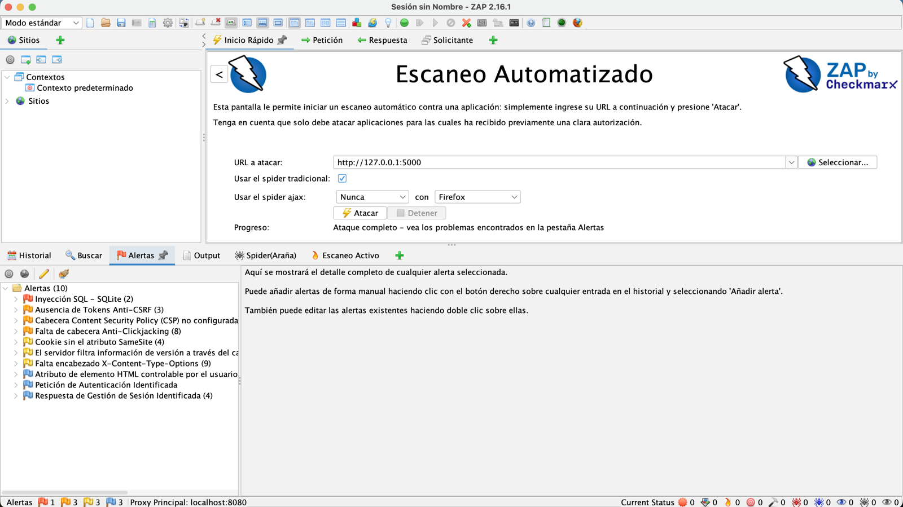
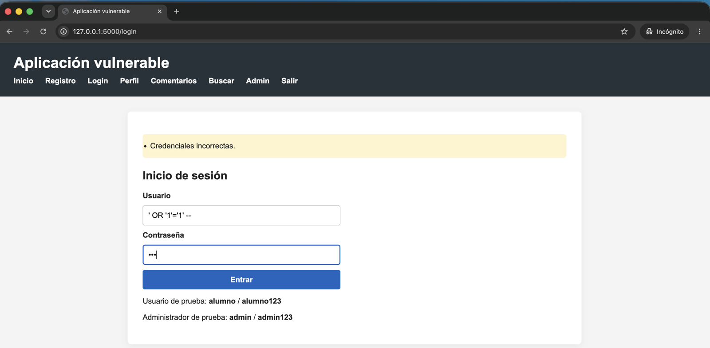
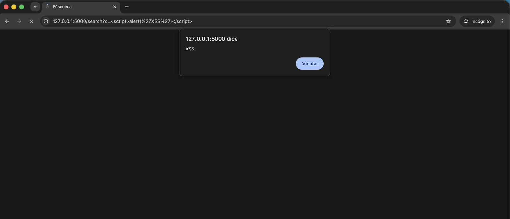
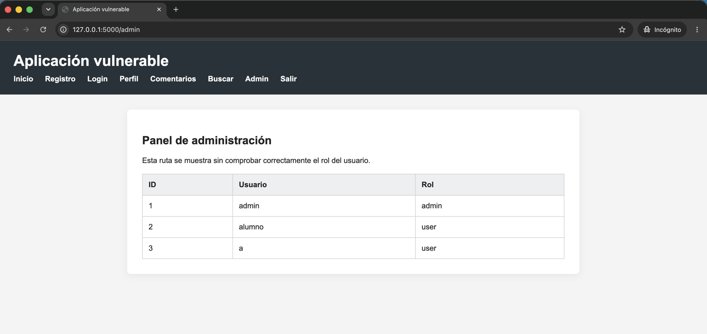

# Web vulnerability analysis with OWASP ZAP

Final degree project (B.Sc. Computer Engineering, Universitat de València, 2026). Grade: **9/10**.

I built a small Flask/SQLite web application with four deliberate vulnerabilities, scanned it with OWASP ZAP 2.16.1 (dynamic application security testing, DAST), and then verified each finding by hand. The main finding is that the automated scan was not enough on its own: two of the four vulnerabilities were only confirmed through manual testing. The thesis also maps every finding to OWASP Top 10 and OWASP ASVS and proposes a secure development methodology based on NIST SSDF, OWASP and the Spanish National Security Framework (ENS).

> [!WARNING]
> **This application is intentionally insecure.** It is meant to run only on `127.0.0.1` for learning purposes. Do not deploy it on a server, expose it to a network, or reuse its code.

- **Thesis (Spanish, 109 pages):** [`docs/TFG_Alberto_Moreno_Alcacer.pdf`](docs/TFG_Alberto_Moreno_Alcacer.pdf)
- **Findings, mapping and proposed fixes:** [`docs/findings.md`](docs/findings.md)
- **Application source:** [`app/`](app/)

## Results

| # | Vulnerability | Location | Detected by ZAP | Confirmed manually | OWASP Top 10:2025 |
|---|---|---|---|---|---|
| 1 | SQL injection (authentication bypass) | `POST /login` | Yes (High) | Yes | A05 Injection |
| 2 | Reflected XSS | `GET /search?q=` | No | Yes | A05 Injection |
| 3 | Broken access control (admin panel without authentication) | `GET /admin` | No | Yes | A01 Broken Access Control |
| 4 | Missing security headers (CSP, `X-Content-Type-Options`, anti-clickjacking) | All responses | Yes (passive scan) | Yes | A02 Security Misconfiguration |

The full ZAP run reported 10 alert types: 1 High, 3 Medium, 3 Low and 3 Informational.

**Why ZAP missed two of them:**

- **Broken access control:** a scanner has no way to know that `/admin` should be restricted. Detecting this needs knowledge of the business logic.
- **Reflected XSS:** ZAP did not raise an XSS alert for the search parameter in this scan. A single payload in the browser was enough to confirm it.

In both cases a clean automated report would have been a false sense of security.

<p align="center">
  
</p>

## Methodology

1. **Build the target.** Flask application with registration, login, profile, comments, search and an admin panel. Each vulnerability is introduced at one specific point in the code and marked with a comment.
2. **Manual baseline.** Before any scan, check that every route loads and that each vulnerability can be reproduced by hand.
3. **Automated scan.** In ZAP's Automated Scan, use `http://127.0.0.1:5000` as the target, with the traditional spider enabled and the AJAX spider disabled (the app does not rely on JavaScript for navigation). The spider is followed by the active scan.
4. **Alert triage.** Review each alert's URL, parameter, risk, confidence and evidence, and separate true positives from noise.
5. **Manual verification.** Confirm the impact of each finding in the browser: login bypass with an SQL payload, a JavaScript alert through `q`, and `/admin` opened from a private window without a session.
6. **Classification and remediation.** Map each finding to OWASP Top 10 and ASVS, and propose a code-level fix.

## Evidence

| SQL injection: login bypass payload | Reflected XSS in `/search` | `/admin` reachable without a session |
|---|---|---|
|  |  |  |

The application's user interface is in Spanish.

## Run it locally

Requires Python 3 (tested on macOS, Apple Silicon).

```bash
cd app
python3 -m venv .venv
source .venv/bin/activate
pip install -r requirements.txt
python init_db.py      # creates database.db with two test users
python app.py          # serves on http://127.0.0.1:5000 only
```

Test accounts, which exist only in the local database: `alumno` / `alumno123` (user) and `admin` / `admin123` (admin).

Only scan this application with ZAP or any other tool on your own machine.

## Proposed remediation

The thesis proposes a fix for each finding. They are described in Chapter 7 and summarised in [`docs/findings.md`](docs/findings.md). They are **not applied** to the code in this repository, which is kept exactly as it was tested.

| Finding | Fix |
|---|---|
| SQL injection | Parameterised queries. Additionally, store password hashes instead of plain text |
| Reflected XSS | Render through a Jinja2 template with auto-escaping instead of building HTML strings |
| Broken access control | Server-side check of session and `admin` role before serving `/admin` |
| Missing headers | Add CSP, `X-Content-Type-Options`, `X-Frame-Options` and `Referrer-Policy` centrally with `@app.after_request` |

## Repository structure

```
.
├── app/                      # Vulnerable Flask application (as tested)
│   ├── app.py
│   ├── init_db.py
│   ├── requirements.txt
│   ├── static/
│   └── templates/
└── docs/
    ├── TFG_Alberto_Moreno_Alcacer.pdf
    ├── findings.md
    └── images/
```

## Skills demonstrated

DAST with OWASP ZAP (spider, active and passive scanning), alert triage and false-positive reasoning, manual validation of web vulnerabilities, OWASP Top 10 and ASVS mapping, secure coding in Python/Flask, and technical documentation.

## License

The application code is released under the [MIT License](LICENSE). The thesis document in `docs/` is © 2026 Alberto Moreno Alcácer, all rights reserved.

---

**Author:** Alberto Moreno Alcácer · [LinkedIn](https://www.linkedin.com/in/alberto-moreno-alcacer/) · Supervisor: Ramón Vicente Cirilo Gimeno
